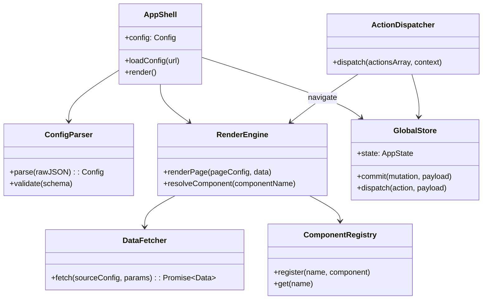
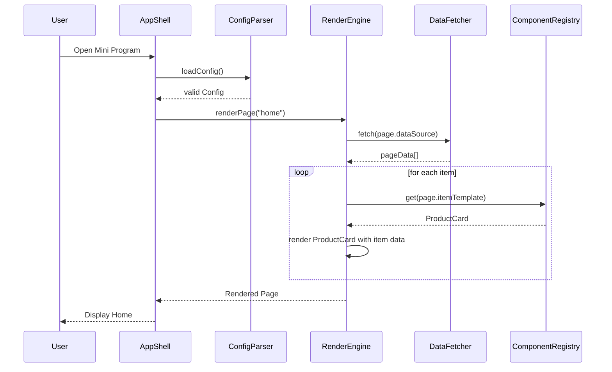
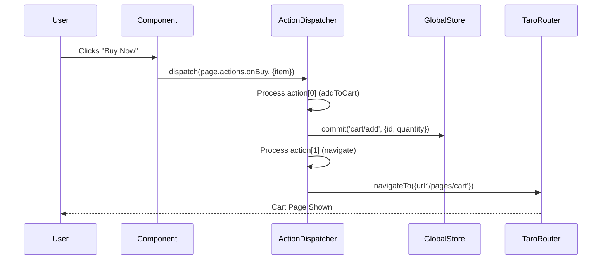

We’ll structure this as a **formal design document** you can review before a single line of code is written. The focus is on the **SSOT JSON Schema**, the **UML models**, and the **UX workflow** for two whitelabel examples.

---

## 1. Core Principles & Approach

- **Taro Framework** – Write once in React/Vue syntax, compile to WeChat Mini Program.
- **Data‑Driven Shell** – All pages, components, navigation, and business rules are defined in a single JSON configuration file loaded at startup.
- **Single Source of Truth (SSOT)** – The JSON config is the *only* place where UI structure, copy, and data bindings live. The codebase never changes between clients.
- **DRY** – Reusable component library (`ProductCard`, `ServiceItem`, `CheckoutButton`) that renders itself based on the config.
- **Array Dispatcher** – Actions (navigation, API calls, state changes) are declared as arrays of operation objects in the config, processed by a central dispatcher.

---

## 2. Proposed JSON Configuration Schema (SSOT)

The config is a single object with three root sections:

- **`meta`** – Client identity, theme, global settings.
- **`pages`** – Array of page definitions (home, list, detail, cart, profile).
- **`components`** – Reusable component library definitions (optional override).

### 2.1 Example Skeleton

```json
{
  "meta": {
    "appName": "BookStore",
    "primaryColor": "#2A4B7C",
    "currency": "USD",
    "features": ["cart", "wishlist", "reviews"]
  },
  "pages": [
    {
      "id": "home",
      "type": "grid",
      "title": "Featured Books",
      "dataSource": {
        "type": "api",
        "endpoint": "/api/books/featured",
        "method": "GET"
      },
      "itemTemplate": "ProductCard",
      "actions": {
        "onItemClick": [
          { "type": "navigate", "target": "detail", "params": { "id": "{{item.id}}" } }
        ]
      }
    },
    {
      "id": "detail",
      "type": "detail",
      "dataSource": {
        "type": "api",
        "endpoint": "/api/books/{{params.id}}"
      },
      "layout": [
        { "component": "ImageGallery", "prop": "images" },
        { "component": "ProductInfo", "prop": "info" },
        { "component": "PurchaseOptions", "prop": "variants" }
      ],
      "actions": {
        "onBuy": [
          { "type": "addToCart", "payload": { "id": "{{item.id}}", "quantity": 1 } },
          { "type": "navigate", "target": "cart" }
        ]
      }
    }
  ]
}
```

### 2.2 Key Schema Concepts

| Section | Purpose |
|---------|---------|
| `dataSource` | Defines where data comes from: `api`, `static`, `store`, or `function`. |
| `itemTemplate` | References a registered Taro component (e.g., `ProductCard`, `ServiceCard`). |
| `actions` | **Array Dispatcher** – each action is an object with `type` and optional `payload`. The dispatcher executes them sequentially. |
| `layout` | For detail pages, an array of components to render, each mapping a config `prop` to a data field. |

---

## 3. UML Diagrams

### 3.1 Class Diagram (Core Modules)



**Explanation:**
- `AppShell` loads the JSON config, then delegates rendering to `RenderEngine`.
- `ActionDispatcher` processes `actions` arrays from config, interacting with `GlobalStore` (Vuex/Redux) and triggering navigation.
- `ComponentRegistry` holds all reusable whitelabel components (ProductCard, ServiceCard, etc.).

### 3.2 Sequence Diagram – Page Rendering with Data



### 3.3 Sequence Diagram – Array Dispatcher Action



---

## 4. UX Workflow Prototypes (Two Whitelabel Examples)

### 4.1 Example A – Bookstore (Digital Products)

**User Journey:**
1. **Home Screen** – Grid of book covers (from JSON `dataSource`), each with title, author, price.
2. **Tap a Book** → **Detail Screen** – Gallery, description, formats (EPUB/PDF), "Buy Now" button.
3. **Buy Now** → **Cart** (if enabled) or direct to **Checkout**.
4. **Checkout** – Collect WeChat user info, show order summary, payment via WeChat Pay.
5. **Order Success** – Link to "My Books" shelf (digital content viewer).

**Key Config Differences for Bookstore:**
- `meta.features` includes `"digitalLibrary"`.
- `ProductCard` component shows author, rating.
- Detail page `PurchaseOptions` displays format selector.

### 4.2 Example B – Prompt Selling (Service)

**User Journey:**
1. **Home Screen** – List of prompt categories (Marketing, Coding, Design) or a search bar.
2. **Tap a Category** → **List Screen** of prompt cards showing preview text, price, usage count.
3. **Tap a Prompt** → **Detail Screen** – Full prompt text preview (blurred), description, "Purchase & Unlock" button.
4. **Purchase** → **Checkout** (similar flow).
5. **Post‑Purchase** → User sees **"My Prompts"** library where they can copy the prompt text.

**Key Config Differences for Prompt Service:**
- `itemTemplate` uses `ServiceCard` (shows short description, copy count).
- Detail page includes a `TextPreviewBlur` component that becomes clear after purchase.
- No physical/digital file delivery; just text access.

### 4.3 Wireframe Descriptions (Textual)

| Screen | Bookstore Wireframe | Prompt Service Wireframe |
|--------|---------------------|--------------------------|
| **Home** | 2‑column grid of book covers. Bottom tab bar: Home, Categories, Cart, Profile. | 1‑column list of category chips, then featured prompts in cards. Tab bar: Home, Search, My Prompts, Profile. |
| **Detail** | Hero image, title/author, price, format dropdown, "Add to Cart" and "Buy Now". | Prompt title, blurred text box with "Unlock to view", price, "Buy Now". |
| **Checkout** | Standard WeChat Pay flow, address not required (digital). | Same, but no delivery options. |

---

## 5. Implementation Plan with Taro

### 5.1 Project Structure

```
src/
├── app.config.ts          // Taro page routing (generated from config)
├── app.tsx                // AppShell: loads config, provides store
├── core/
│   ├── ConfigParser.ts
│   ├── RenderEngine.tsx
│   ├── ActionDispatcher.ts
│   ├── DataFetcher.ts
│   └── ComponentRegistry.ts
├── components/
│   ├── ProductCard/
│   ├── ServiceCard/
│   ├── ImageGallery/
│   └── ... (all whitelabel components)
├── pages/
│   └── dynamic/           // Single dynamic page that renders based on config
│       └── index.tsx
└── store/                 // Global state (Redux/Vuex)
```

### 5.2 Key Technical Steps

1. **Dynamic Page Registration**  
   - At runtime, parse `config.pages` and use `Taro.addPage()` to register each page to the same dynamic component.

2. **RenderEngine Implementation**  
   - A React component that receives `pageId` via router params, finds the config, fetches data, and renders components via `ComponentRegistry`.

3. **Array Dispatcher**  
   - A pure function that iterates over an `actions` array and executes each. Supports async actions (API calls) with `await`.

4. **Whitelabel Components**  
   - Each component accepts a `config` prop (the JSON fragment for its section) and `data` prop. They emit events (e.g., `onAction`) which are passed back to the dispatcher.

5. **Theme & Styling**  
   - Use Taro’s CSS variables injected from `meta` (primaryColor, etc.) to style components consistently.

### 5.3 Example Taro Component (ProductCard)

```tsx
// components/ProductCard/index.tsx
import { View, Image, Text } from '@tarojs/components'

interface Props {
  data: any;
  config: any;        // from JSON (e.g., showRating, priceFormat)
  onAction: (actionArray: any[], context: any) => void;
}

const ProductCard: React.FC<Props> = ({ data, config, onAction }) => {
  const handleClick = () => {
    if (config.onClick) {
      onAction(config.onClick, { item: data });
    }
  };

  return (
    <View className="product-card" onClick={handleClick}>
      <Image src={data.cover} />
      <Text>{data.title}</Text>
      <Text>{config.pricePrefix}{data.price}</Text>
    </View>
  );
};
```

---

## 6. Review & Next Steps

This plan establishes:
- A **JSON schema** that fully defines the app.
- **UML diagrams** clarifying the architecture and interaction flows.
- **UX workflows** for two distinct whitelabel use cases.
- A **Taro implementation strategy** that keeps code DRY and SSOT‑compliant.

**After your review and approval, I will proceed with:**
1. Writing the exact JSON schema specification (with TypeScript interfaces).
2. Implementing the core modules (`ConfigParser`, `RenderEngine`, `ActionDispatcher`).
3. Creating the base whitelabel component library.
4. Building a sample config for both the bookstore and prompt service.
---
You can use  Tailwind CSS
---
